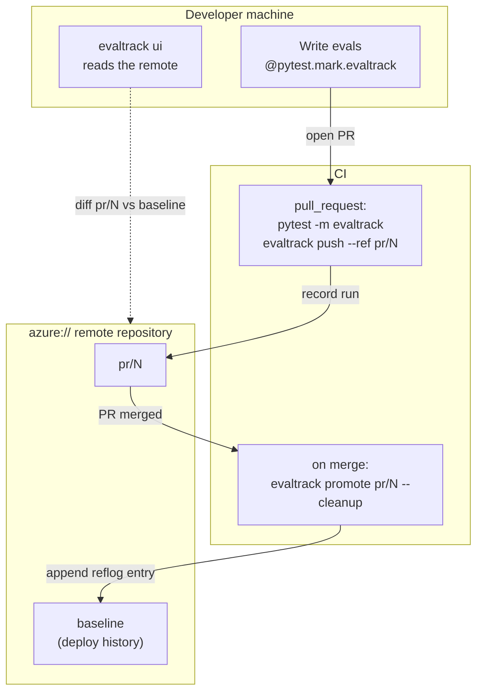
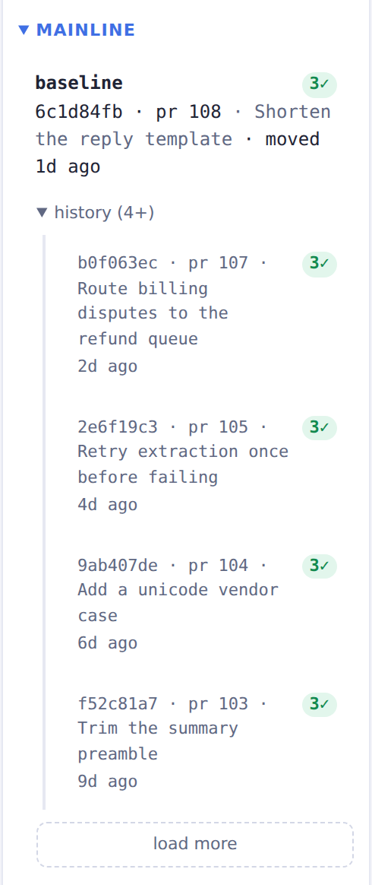
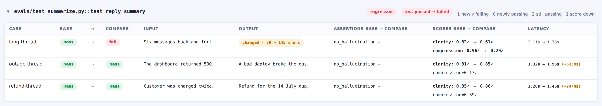

# CI/CD

Your evals are pytest tests, so the CI you already have runs them. This page shows how to add the
evaltrack CLI to it. There are two setups:

- **[Without a remote]**, CI writes a report of the run for each pull request and links it on the
  pull request. You do not need a storage account for this.
- **[With a remote]**, each pull request pushes its run to a shared repository, and a merge promotes
  that run to [`baseline`][baseline]. evaltrack then keeps each run, and you can compare a pull
  request with what is deployed.

The commands are the same in every CI system. [GitHub Actions] has complete workflows for both
setups.

## Without a remote

Run the evals, then write the run as a report:

```bash
export EVALTRACK_COMMIT="$COMMIT_SHA"  # (1)!
export EVALTRACK_BRANCH="$BRANCH_NAME"

pytest -m evaltrack --evaltrack-run-file run.json
evaltrack report --run-file run.json --output evaltrack-report.html
```

1. The run records the commit and the branch. In CI, git often has no branch checked out, and the
   commit can be a temporary merge commit. So set both yourself.

Upload `evaltrack-report.html` as an artifact of the job. Then link it in a comment on the pull
request. The page opens from disk, with no server and no network. It shows each case of the run with
its scores and verdicts, as the dashboard does.

What a report without a remote does not have:

- It does not show earlier runs, and it does not compare the run with `baseline`.
- It has no [cross-run reliability] estimate. That estimate needs earlier runs.

The page holds every input and output that the run recorded, so keep the artifact as private as the
run.

To add a remote later, configure it and follow the [PR pipeline]. The report then compares the run
with `baseline`, and the [promote pipeline] moves `baseline` on each merge.

## With a remote

Every pull request records a run and pushes it to a shared repository, and a merge promotes that run
to `baseline`. The examples use an `azure://` remote. evaltrack does not require a promote at merge.
If your code ships at a different time than the merge (for example with GitOps), see [Adapting the
flow].

### The flow



### Prerequisites

You need a shared remote and credentials for it. The examples use `azure://`, and an `s3://` remote
works the same way with the AWS credentials in place of the Azure ones:

- For the URL shape and how evaltrack authenticates, see [Repositories › Azure Blob Storage] or
  [Repositories › Amazon S3].
- Point `[tool.evaltrack].remote` at the remote, so `evaltrack ui` mounts it next to your local
  runs:

  ```toml
  [tool.evaltrack]
  local  = "./.evaltrack"
  remote = "azure://account/evals"
  ```

- Put `AZURE_CLIENT_ID`, `AZURE_TENANT_ID` and `AZURE_CLIENT_SECRET` in your CI's secret store,
  where `DefaultAzureCredential` reads them, along with whatever the evals themselves need (an
  `OPENAI_API_KEY`, say).

### PR pipeline

Run the evals, push the run under `pr/{n}`, and write a report of it:

```bash
export EVALTRACK_COMMIT="$COMMIT_SHA"  # (1)!
export EVALTRACK_BRANCH="$BRANCH_NAME"

pytest -m evaltrack --evaltrack-run-file run.json

evaltrack push --run-file run.json \
  --ref "pr/$PR_NUMBER" \
  --pr "$PR_NUMBER" \
  --title "$PR_TITLE" \
  --commit "$COMMIT_SHA"  # (2)!

evaltrack report --ref "pr/$PR_NUMBER" --output evaltrack-report.html
```

1. As in [Without a remote], the run records these.
2. `--commit` records the same SHA on the ref's reflog entry, next to the PR.

That is the whole integration. What the job around it has to get right:

- **Install `evaltrack[azure]`**, or `evaltrack[s3]`, alongside your project's own dependencies, or
  the push fails.
- **Name the remote once.** Set `EVALTRACK_REMOTE` for the job and neither command needs to name a
  repository (see [Configuration › Precedence rules](./configuration.md#precedence-rules)).
- **Push even when an eval failed.** The run is written when the pytest session finishes, whatever
  the verdicts, so guard the push on the file existing rather than on the test step passing. The run
  you most need in the dashboard is the one that caught a regression.
- **Do not run the eval step under [pytest-xdist]** (`-n`). evaltrack does not support it and fails
  every marked test.
- **Override the git context**, as above, or the run records no commit. See
  [Configuration › Environment variables](./configuration.md#environment-variables).

`--pr` and `--title` record the PR number and title on the ref, so the dashboard shows which PR a
ref represents. With `pr_url_template` set, it links the number to the PR.

Upload the report and link it on the pull request, as in [Without a remote]. A reviewer can then see
the run without the dashboard. With a remote, the report also shows the history of the run over the
mainline and the changes from `baseline` to the run. On the first pull request of a project there is
no `baseline` yet, so the report shows the run alone. See [CLI › report](./cli.md#evaltrack-report).

### Promote pipeline

When the PR merges, point `baseline` at its run:

```bash
evaltrack promote "pr/$PR_NUMBER" --commit "$MERGE_COMMIT_SHA" --cleanup
```

- `--cleanup` deletes the merged `pr/{n}` ref and the runs in its history that no other ref reaches,
  so the PR stops showing as open in the dashboard.
- Run one job at a time per PR, and one promote at a time. Both write refs, and `--cleanup` works
  out what to delete before deleting it. A concurrent writer can leave `pr/{n}` on an older commit's
  run, or lose a run it had just referenced.

A promote onto the run `baseline` already points at records nothing, so a retried job is safe. See
[Moving a ref is idempotent](./repositories.md#moving-a-ref-is-idempotent).

The baseline reflog reads as a timeline of promoted runs:



## GitHub Actions

These workflows are examples of the workflows shown above in GitHub Actions. They use uv, and the
project must have evaltrack in its dependencies. With a remote, it must have `evaltrack[azure]` or
`evaltrack[s3]`. If you use a different tool than uv, change the install step and remove `uv run`.

### Workflow without a remote

```yaml title=".github/workflows/evals.yml"
name: Evals

on:
  pull_request:

jobs:
  evals:
    runs-on: ubuntu-latest
    permissions:
      contents: read
      pull-requests: write # (1)!
    steps:
      - uses: actions/checkout@v7
      - uses: astral-sh/setup-uv@v10
      - run: uv sync --locked

      - name: Run evals
        id: evals
        env:
          OPENAI_API_KEY: ${{ secrets.OPENAI_API_KEY }}
          EVALTRACK_COMMIT: ${{ github.event.pull_request.head.sha }}
          EVALTRACK_BRANCH: ${{ github.head_ref }}
        run: uv run pytest -m evaltrack --evaltrack-run-file run.json

      - name: Write the eval report
        if: ${{ !cancelled() && hashFiles('run.json') != '' }} # (2)!
        run: uv run evaltrack report --run-file run.json --output evaltrack-report.html

      - name: Upload the eval report
        id: upload
        if: ${{ !cancelled() && hashFiles('evaltrack-report.html') != '' }}
        uses: actions/upload-artifact@v7
        with:
          name: evaltrack-report-pr-${{ github.event.pull_request.number }}
          path: evaltrack-report.html

      - name: Link the eval report on the PR
        if: ${{ !cancelled() && steps.upload.outcome == 'success' }}
        env:
          GH_TOKEN: ${{ github.token }}
          REPORT_URL: ${{ steps.upload.outputs.artifact-url }}
          EVALS_OUTCOME: ${{ steps.evals.outcome }}
          PR: ${{ github.event.pull_request.number }}
          SHA: ${{ github.event.pull_request.head.sha }}
        run: | # (3)!
          verdict="Evals failed"
          if [ "$EVALS_OUTCOME" = "success" ]; then verdict="Evals passed"; fi
          gh pr comment "$PR" --edit-last --create-if-none \
            --body "**$verdict** on \`${SHA:0:7}\`. [Download the eval report]($REPORT_URL)."
```

1. The last step writes a comment on the pull request. The token needs this permission for that.
2. pytest writes the run file at the end, also when an eval fails. So this step runs after a failed
   eval too, because that report is the most useful one. The job still fails.
3. Edits the comment from the previous push, so the pull request has one comment. If another
   workflow also comments with `GITHUB_TOKEN`, this step can edit that comment instead.

The link opens the artifact on GitHub. To download it, the reader must sign in and have read access
to the repository. The download is a zip file with the report in it.

### Workflows with a remote

Put the remote in `[tool.evaltrack].remote` and its credentials in the repository secrets, as in
[Prerequisites]. The pull request workflow pushes the run before it writes the report:

```yaml title=".github/workflows/evals.yml"
name: Evals

on:
  pull_request:

jobs:
  evals:
    runs-on: ubuntu-latest
    permissions:
      contents: read
      pull-requests: write
    concurrency: # (1)!
      group: evals-${{ github.event.pull_request.number }}
      cancel-in-progress: false
    env:
      AZURE_CLIENT_ID: ${{ secrets.AZURE_CLIENT_ID }}
      AZURE_TENANT_ID: ${{ secrets.AZURE_TENANT_ID }}
      AZURE_CLIENT_SECRET: ${{ secrets.AZURE_CLIENT_SECRET }}
    steps:
      - uses: actions/checkout@v7
      - uses: astral-sh/setup-uv@v10
      - run: uv sync --locked

      - name: Run evals
        id: evals
        env:
          OPENAI_API_KEY: ${{ secrets.OPENAI_API_KEY }}
          EVALTRACK_COMMIT: ${{ github.event.pull_request.head.sha }}
          EVALTRACK_BRANCH: ${{ github.head_ref }}
        run: uv run pytest -m evaltrack --evaltrack-run-file run.json

      - name: Push the run
        id: push
        if: ${{ !cancelled() && hashFiles('run.json') != '' }}
        env:
          PR: ${{ github.event.pull_request.number }}
          PR_TITLE: ${{ github.event.pull_request.title }} # (2)!
          SHA: ${{ github.event.pull_request.head.sha }}
        run: |
          uv run evaltrack push --run-file run.json \
            --ref "pr/$PR" --pr "$PR" --title "$PR_TITLE" --commit "$SHA"

      - name: Write the eval report
        if: ${{ !cancelled() && steps.push.outcome == 'success' }}
        env:
          PR: ${{ github.event.pull_request.number }}
        run: uv run evaltrack report --ref "pr/$PR" --output evaltrack-report.html

      - name: Upload the eval report
        id: upload
        if: ${{ !cancelled() && hashFiles('evaltrack-report.html') != '' }}
        uses: actions/upload-artifact@v7
        with:
          name: evaltrack-report-pr-${{ github.event.pull_request.number }}
          path: evaltrack-report.html

      - name: Link the eval report on the PR
        if: ${{ !cancelled() && steps.upload.outcome == 'success' }}
        env:
          GH_TOKEN: ${{ github.token }}
          REPORT_URL: ${{ steps.upload.outputs.artifact-url }}
          EVALS_OUTCOME: ${{ steps.evals.outcome }}
          PR: ${{ github.event.pull_request.number }}
          SHA: ${{ github.event.pull_request.head.sha }}
        run: |
          verdict="Evals failed"
          if [ "$EVALS_OUTCOME" = "success" ]; then verdict="Evals passed"; fi
          gh pr comment "$PR" --edit-last --create-if-none \
            --body "**$verdict** on \`${SHA:0:7}\`. [Download the eval report]($REPORT_URL)."
```

1. Jobs for the same pull request run one at a time, because each one writes `pr/{n}`.
2. If you put the title directly in the script, the shell can run text from it, such as `$(...)`.
   `env` passes the title as plain text.

The promote workflow starts when a pull request closes. If the pull request closed without a merge,
the job does not run:

```yaml title=".github/workflows/promote.yml"
name: Promote

on:
  pull_request:
    types: [closed]

jobs:
  promote:
    if: github.event.pull_request.merged == true
    runs-on: ubuntu-latest
    concurrency: # (1)!
      group: evaltrack-promote
      cancel-in-progress: false
    env:
      AZURE_CLIENT_ID: ${{ secrets.AZURE_CLIENT_ID }}
      AZURE_TENANT_ID: ${{ secrets.AZURE_TENANT_ID }}
      AZURE_CLIENT_SECRET: ${{ secrets.AZURE_CLIENT_SECRET }}
    steps:
      - uses: actions/checkout@v7
      - uses: astral-sh/setup-uv@v10
      - run: uv sync --locked

      - name: Promote the run to baseline
        env:
          PR: ${{ github.event.pull_request.number }}
          SHA: ${{ github.event.pull_request.merge_commit_sha }}
        run: uv run evaltrack promote "pr/$PR" --commit "$SHA" --cleanup # (2)!
```

1. Promotes run one at a time, so two merges close together cannot change `baseline` at the same
   time.
2. If no run was ever pushed for the pull request, there is no `pr/{n}` and the step fails.

## Adapting the flow to your delivery process

`baseline` is the run you compare against. `promote` is a plain CLI call, so run it at whatever
event means shipped in your process. I promote on merge, which suits trunk-based development.

Promoting later than merge leaves `pr/{n}` refs standing until their run ships, and a ref reaches
every run in its history. Delete them once their PR is closed.

The remote has one `baseline`. The dashboard's Mainline section and the [cross-run reliability
estimate][cross-run reliability] read it.

## Reviewing a PR

The PR's run is in the shared remote, so a reviewer can see its evals without checking the branch
out. `evaltrack ui` lists each PR run under **Pull requests**. Pick one as the compare run against
`baseline` to see which cases changed.



## Flaky evals in CI

Give nondeterministic evals a `flake_reruns` budget on the marker. A flaky case then does not fail
the PR. See [Flakiness & reliability](./flakiness.md).

Prefer `flake_reruns` over a rerun of a red CI job. A job rerun discards the failed attempts and
biases the [tracked pass-rate][cross-run reliability] upward.

---

**Related:** [CLI](./cli.md) · [Repositories and storage](./repositories.md) ·
[Flakiness & reliability](./flakiness.md)

[baseline]: ./repositories.md#baseline-and-mainline
[adapting the flow]: #adapting-the-flow-to-your-delivery-process
[without a remote]: #without-a-remote
[with a remote]: #with-a-remote
[github actions]: #github-actions
[prerequisites]: #prerequisites
[promote pipeline]: #promote-pipeline
[pr pipeline]: #pr-pipeline
[repositories › azure blob storage]: ./repositories.md#azure-blob-storage
[repositories › amazon s3]: ./repositories.md#amazon-s3
[pytest-xdist]: https://github.com/pytest-dev/pytest-xdist
[cross-run reliability]: ./flakiness.md#cross-run-reliability
